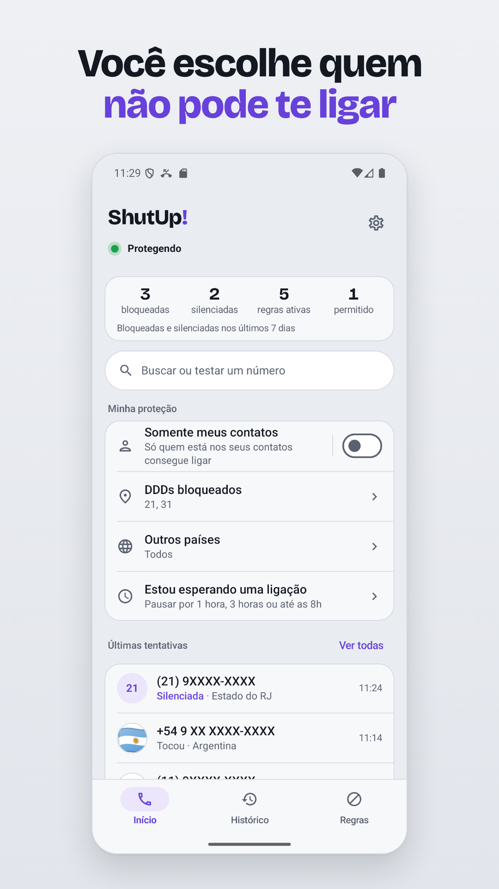
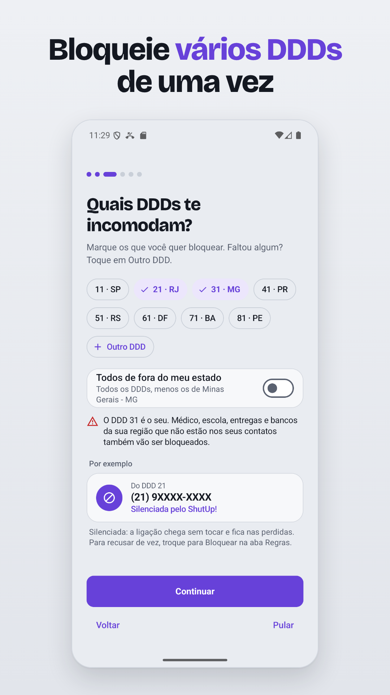
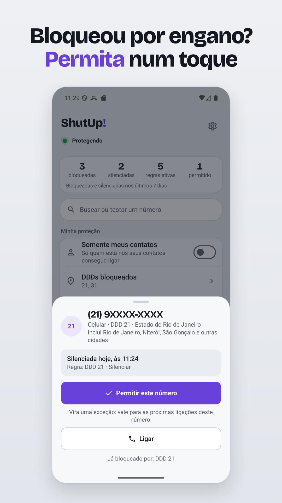
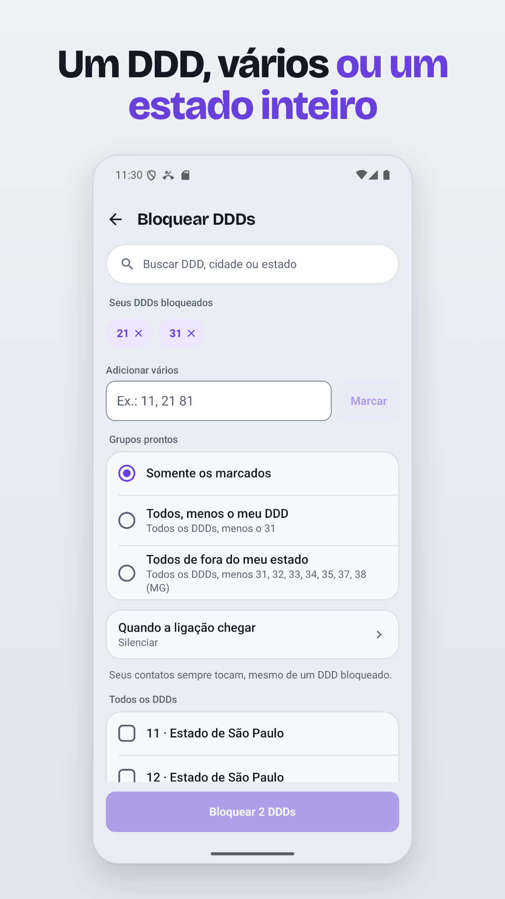
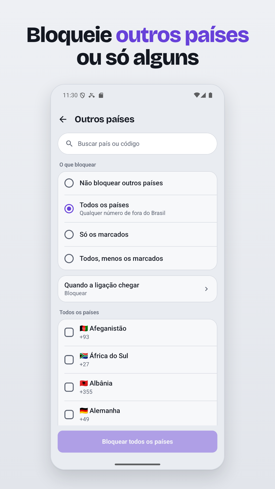
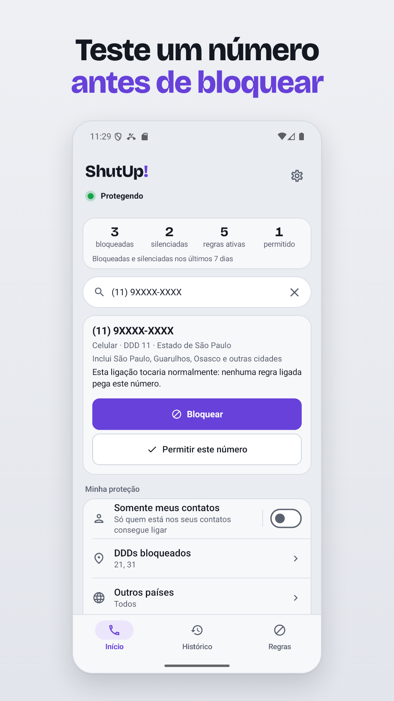
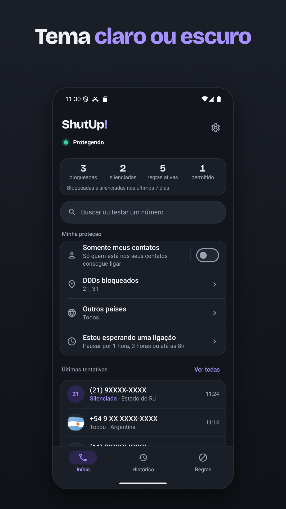

  

<h1 align="center">ShutUp!</h1>

<b>Você escolhe quem não pode te ligar.</b>

  Em breve na Google Play ·
  <a href="https://goklahlabs.com.br/shutup">Página do app</a> ·
  <a href="CHANGELOG.md">Novidades</a>

O ShutUp! bloqueia ligações pelas regras que você escolhe: por DDD, por número, de outros países ou de quem não está nos seus contatos. Nada de lista secreta: você decide.

Gratuito, sem anúncios, sem conta e sem internet. Tudo fica no seu celular.

## O que ele faz

**Quem não pode te ligar.** Marque DDDs inteiros, um estado inteiro de uma vez ou todos os DDDs de fora do seu estado. Bloqueie um número completo ou todos os que começam do mesmo jeito. Bloqueie ligações de outros países: todos, só os que você marcar ou todos menos esses. Ou deixe tocar só quem está nos seus contatos.

**Bloquear ou Silenciar.** Para cada regra, você escolhe: a ligação é recusada antes de tocar, ou chega sem som e fica nas perdidas.

**Seus contatos sempre tocam.** E os números que você permitir também, mesmo que não sejam contatos. Está esperando uma ligação? Pause o bloqueio por 1 hora, 3 horas ou até as 8h.

**Veja quem tentou e corrija.** O Histórico mostra quem foi bloqueado, silenciado ou tocou, agrupado por número e com a regra que agiu. Bloqueou alguém por engano? Toque no número e permita. Quer saber o que aconteceria com um número? Busque antes de bloquear.

**Do seu jeito.** Só observar, para experimentar as regras sem bloquear nada. Resumo em notificação, opcional, sem mostrar números. Tema claro ou escuro. Bloqueie um número direto de outro app, pelo Compartilhar.

## Telas

  
  
  
  

  
  
  

## Como começar

1. Instale e abra o ShutUp!. A primeira abertura pergunta, uma tela por vez, quais DDDs e ligações te incomodam. Pode pular e ajustar depois, na aba Regras.
2. Quando o Android perguntar, escolha o ShutUp! como app de **identificação de chamadas e spam**. Sem isso, o Android não deixa o app filtrar as ligações.
3. Pronto. O ShutUp! funciona com o app fechado e com a tela bloqueada.

Não achou a opção? Procure "identificação de chamadas" na busca das Configurações do Android.

## O que ele não faz

- Não descobre sozinho quem é golpe ou spam: segue só as suas regras.
- Não bloqueia números ocultos: o Android não deixa apps bloquearem. Use o bloqueio do app Telefone.
- Não bloqueia mensagens, WhatsApp nem ligações de outros apps.
- Não garante que um número é de quem diz ser: o número que aparece pode ser falsificado.

Funciona do Android 10 em diante.

## Privacidade

O ShutUp! não tem permissão de internet: nada sai do seu celular. Não tem conta, anúncios nem rastreamento, e não lê seus contatos, mensagens nem o registro de chamadas. As suas regras e o histórico ficam só no celular; o histórico é apagado sozinho depois de 7, 30 ou 90 dias, à sua escolha. [Política de privacidade](https://goklahlabs.com.br/shutup/privacidade/).

## Problemas e sugestões

- **Algo não funcionou?** Abra um [Problema](../../issues/new/choose), dizendo a versão do app e o modelo do celular. **Não coloque números de telefone completos**: escreva só o DDD ou o começo, como (11) 9XXXX-XXXX.
- **Tem uma ideia?** Abra uma [Sugestão](../../issues/new/choose).
- **Dúvidas:** escreva para **support@goklahlabs.com.br**, ou use o "Fale conosco" nos Ajustes do app.

---

  Desenvolvido por <b>GoklahLabs</b> 
  <a href="https://goklahlabs.com.br">goklahlabs.com.br</a> ·
  <a href="https://instagram.com/goklah.labs">Instagram @goklah.labs</a> ·
  <a href="mailto:hello@goklahlabs.com.br">hello@goklahlabs.com.br</a>

